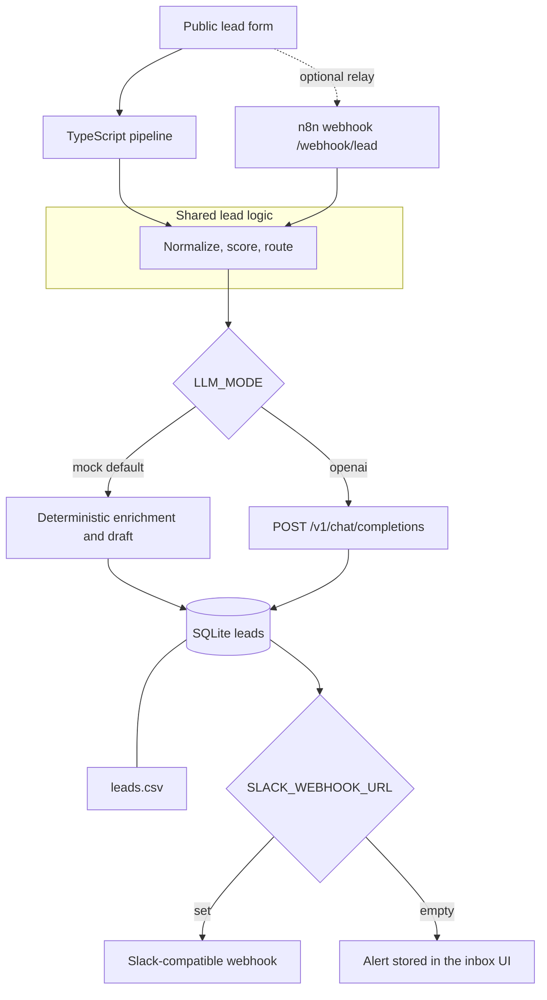
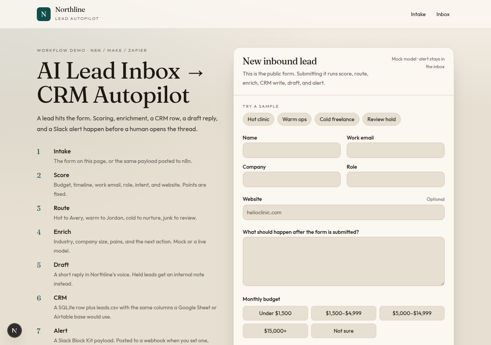
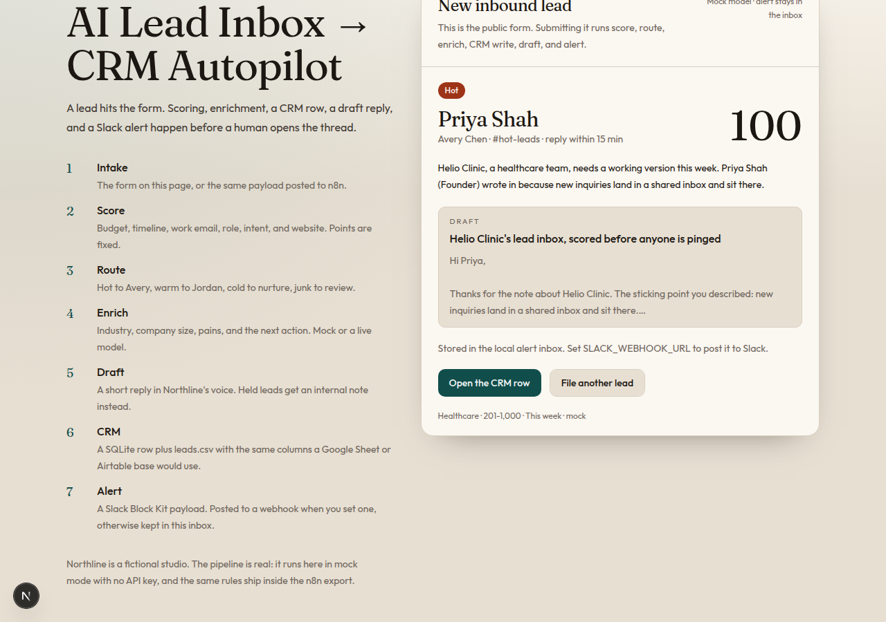
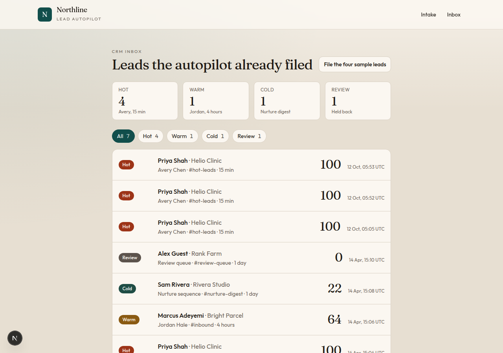
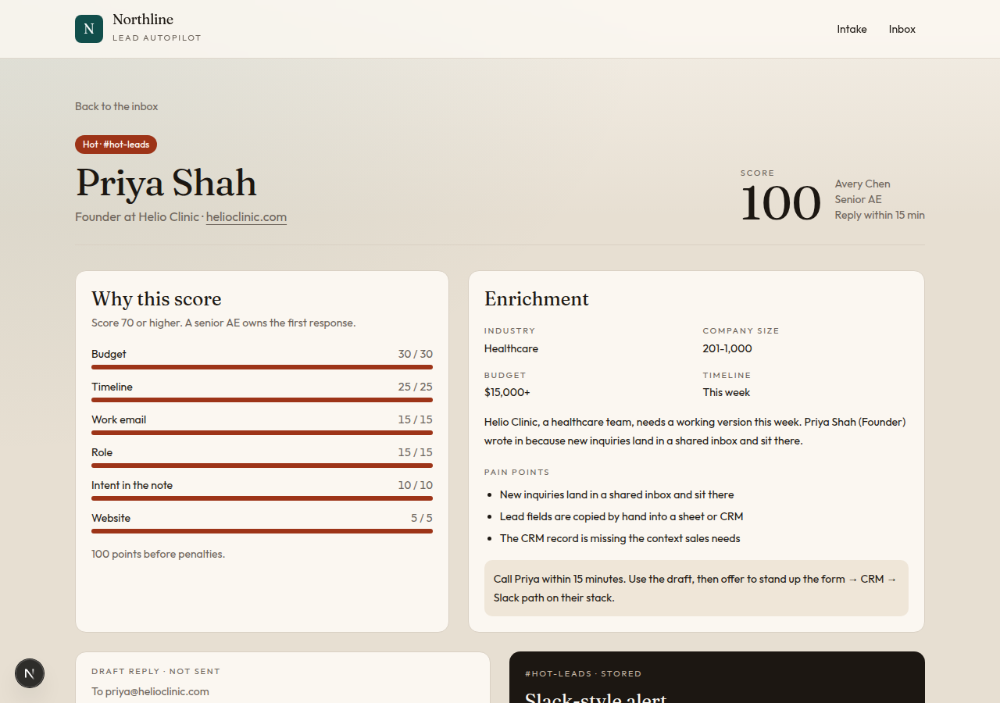

# AI Lead Inbox → CRM Autopilot

A lead submitted on a public form is scored, enriched, written to a CRM-shaped store, given a draft reply, and announced with a Slack-compatible alert. The same rules run in this Next.js app and inside an n8n workflow you can import.

Northline, the studio named in the draft emails, is fictional. The pipeline is not. Mock mode needs no API key.

## Architecture



The n8n graph scores in a Code node, then calls this app for the AI step, the CRM write, and the alert. Point the AI node at OpenAI directly when you want n8n to hold the model credential. See [n8n](#n8n).

## What a run produces

| Lead | Score | Tier | Owner | Channel | SLA |
| --- | --- | --- | --- | --- | --- |
| Priya Shah, Helio Clinic | 100 | hot | Avery Chen | #hot-leads | 15 min |
| Marcus Adeyemi, Bright Parcel | 64 | warm | Jordan Hale | #inbound | 4 hours |
| Sam Rivera, Rivera Studio | 22 | cold | Nurture sequence | #nurture-digest | 1 day |
| Alex Guest, Rank Farm | 0 | review | Review queue | #review-queue | 1 day |

Captured with `npm run autopilot -- --write-sample` in mock mode. Full records are in [samples/e2e-run.json](samples/e2e-run.json), the sheet is [samples/leads.csv](samples/leads.csv), and the hot alert is [samples/slack-alert.json](samples/slack-alert.json).

The same path in the browser, still in mock mode:









The form also stacks on a phone-width viewport: [docs/screenshots/intake-mobile.png](docs/screenshots/intake-mobile.png).

Hot alert text:

```text
Hot lead: Priya Shah at Helio Clinic — score 100 — Avery Chen — 15m SLA
```

Draft subject: `Helio Clinic's lead inbox, scored before anyone is pinged`.

The Rank Farm row is a guest-post pitch from a disposable inbox. Sales is not paged. The draft is an internal note that starts with "Do not send".

## Scoring and routing

Points, capped at 100:

| Signal | Points |
| --- | --- |
| Budget $15,000+ / $5,000–$14,999 / $1,500–$4,999 / under $1,500 / not specified | 30 / 22 / 14 / 6 / 4 |
| Timeline this week / this month / this quarter / this year / exploring | 25 / 22 / 16 / 8 / 4 |
| Work email / free inbox (Gmail, Outlook, iCloud, …) / disposable | 15 / 4 / 0 and a review flag |
| Founder, CEO, owner, partner / VP, director, head, chief / manager, lead / everyone else | 15 / 12 / 8 / 4 |
| Note mentions automation (n8n, Zapier, Make, workflow) | +4 |
| Note mentions a CRM, HubSpot, Salesforce, Airtable, or a spreadsheet | +3 |
| Note mentions leads, inbound, or pipeline | +3, intent capped at 10 |
| Website present | 5 |
| Disposable inbox | −40 and tier `disqualified` |
| Guest-post, backlink, crypto-airdrop, or follower-buy language | −50 and tier `disqualified` |

Routing uses the score after penalties:

| Score | Tier | Owner | Slack channel | SLA |
| --- | --- | --- | --- | --- |
| 70–100 | hot | Avery Chen, Senior AE | #hot-leads | 15 min |
| 40–69 | warm | Jordan Hale, Account executive | #inbound | 4 hours |
| 0–39 | cold | Nurture sequence | #nurture-digest | 1 day |
| spam or disposable flag | disqualified | Review queue | #review-queue | 1 day, no sales email |

Boundaries are tested: 70 is hot, 69 is warm, 40 is warm, 39 is cold. A founder with a huge budget still goes to review if the message is a backlink pitch.

## CRM shape

SQLite lives at `$DATA_DIR/crm.sqlite` (default `./data`, gitignored). Every write rewrites `leads.csv` in the same folder, UTF-8 with a BOM, RFC 4180 quoting. Headers:

`Lead ID, Created At, Full Name, Email, Company, Role, Website, Need, Monthly Budget USD, Budget Label, Timeline, Source, Score, Tier, Owner, Owner Role, Slack Channel, SLA Minutes, Route Reason, Industry, Company Size, Intent, Pain Points, Personalization Hooks, Next Action, Draft Subject, Draft Body, LLM Provider, LLM Model, Alert Status, Origin`

Airtable field types for the same columns: single line text for names and ids, email for Email, url for Website, long text for Need, Intent, Pain Points, Personalization Hooks, Next Action, and Draft Body, number for Monthly Budget USD, Score, and SLA Minutes, single select for Timeline, Tier, Budget Label, and Origin, date time for Created At.

Google Sheets: File → Import → Upload `leads.csv`, or append the same columns with a Sheets node in n8n.

## LLM providers

`src/lib/llm.js` picks the provider from the environment.

| Variable | Default | Purpose |
| --- | --- | --- |
| `LLM_MODE` | `mock` | `mock` or `openai` |
| `LLM_BASE_URL` | `https://api.openai.com/v1` | Any OpenAI-compatible `/chat/completions` base |
| `LLM_API_KEY` | empty | Required only when `LLM_MODE=openai` |
| `LLM_MODEL` | `gpt-4o-mini` | Model name sent to that API |
| `LLM_TIMEOUT_MS` | `20000` | Request timeout |
| `SLACK_WEBHOOK_URL` | empty | Incoming webhook. Empty keeps the alert in the app |
| `N8N_WEBHOOK_URL` | `http://127.0.0.1:5678/webhook/lead` | Used by the form's n8n checkbox |
| `DATA_DIR` | `./data` | SQLite and CSV directory |

Mock mode is a pure function of the lead, the score, and the route. The same input always returns the same industry, pains, and draft. It does not call the network. OpenAI mode sends one JSON-object chat completion and refuses the response if the draft or the other required keys are missing. If `LLM_MODE=openai` and the key is empty, the run fails before a CRM row is written.

Copy [.env.example](.env.example) to `.env` only when you want a live model or a real Slack webhook. `.env` is gitignored. This repo does not contain keys.

## Run it locally

```bash
npm install
npm test
npm run dev
```

Open [http://127.0.0.1:4317](http://127.0.0.1:4317). Submit the form, or use the sample chips, then open Inbox. "File the four sample leads" runs the same fixtures through the API.

Replay the captured path without the server:

```bash
npm run autopilot -- --write-sample
```

`npm test` covers the rubric, tier boundaries, mock determinism, CSV quoting, the OpenAI-without-a-key failure, and the fact that the n8n Code nodes contain the same `scoreLead` / `routeLead` source as the app.

## Docker Compose

```bash
docker compose up --build
```

- App: [http://localhost:4317](http://localhost:4317)
- n8n: [http://localhost:5678](http://localhost:5678)

On first boot the n8n container imports [n8n/ai-lead-inbox.workflow.json](n8n/ai-lead-inbox.workflow.json). Create the local owner account n8n asks for, open the workflow, and publish it. Production webhook: `POST http://localhost:5678/webhook/lead`.

The Code node `pipelineBaseUrl` is `http://web:4317`, which is the app on the compose network. If you run n8n on the host instead, change that constant to `http://127.0.0.1:4317`.

The form checkbox "Send this lead through the n8n webhook" posts to the app, which relays to `N8N_WEBHOOK_URL`. Inside compose that URL is `http://n8n:5678/webhook/lead`. Leave the checkbox off to run the TypeScript pipeline with n8n stopped.

Image pin: `n8nio/n8n:2.43.3`. The app image is `node:22-bookworm-slim` so `node:sqlite` is available.

## n8n

Import path: n8n menu → Import from file → `n8n/ai-lead-inbox.workflow.json`.

Nodes, in order:

1. **Lead webhook** — `POST /lead`, response comes from the last node.
2. **Score and route** — the shared JavaScript. Edit `CONFIG.pipelineBaseUrl` here.
3. **Valid lead?** — invalid payloads get a 400 from **Reject invalid lead**.
4. **AI enrich** — `POST {pipelineBaseUrl}/api/llm/enrich`. Honors the app's `LLM_MODE`.
5. **Assemble record** — merges enrichment into the CRM record and the Slack payload.
6. **Write CRM row** — `POST /api/crm/commit`.
7. **Post Slack-style alert** — `POST /api/alerts`. The app stores it and forwards to `SLACK_WEBHOOK_URL` when that variable is set.
8. **Reply to caller** — returns the stored lead and alert.

**OpenAI direct** is on the canvas and disabled. It is an HTTP Request to `https://api.openai.com/v1/chat/completions` with a Header Auth credential id of `PLACEHOLDER_OPENAI_HEADER_AUTH`. To use it: create a Header Auth credential whose name is `Authorization` and whose value is `Bearer <your key>`, attach it, disable **AI enrich**, and connect **OpenAI direct** between **Valid lead?** and **Assemble record**. For a non-OpenAI base URL, change the node URL and keep `/chat/completions`. Do not paste the key into the workflow JSON.

To swap the CRM write for Google Sheets or Airtable, replace **Write CRM row** with that node and map the fields listed above. To post from the native Slack node, replace **Post Slack-style alert** and map `alert.text` plus the blocks. Sticky notes on the canvas repeat this.

Regenerate the export after editing `src/lib/lead-logic.js`:

```bash
npm run workflow:build
npm run workflow:check
```

## Make and Zapier

The scenario is the same seven steps. You do not need this repo running if you paste the scoring functions into a code module and call your own model and CRM.

| Step | Make | Zapier |
| --- | --- | --- |
| Trigger | Custom webhook, or a form's webhook | Webhooks by Zapier → Catch Hook, or the form's native trigger |
| Score and route | Tools → Run JavaScript. Paste `scoreLead` and `routeLead` from `src/lib/lead-logic.js` | Code by Zapier, JavaScript, same functions |
| Branch | Router on `tier` | Paths on `tier` |
| Enrich | HTTP `POST` to this app's `/api/llm/enrich`, or the OpenAI module with a JSON response and the prompt from `buildEnrichmentPrompt` | Webhooks POST to `/api/llm/enrich`, or the OpenAI action |
| CRM | Google Sheets → Add a row, or Airtable → Create a record | Google Sheets or Airtable, same columns |
| Draft | Already inside the enrichment JSON (`draftSubject`, `draftBody`). Optional: Gmail → Create draft | Same. Optional: Gmail Create Draft |
| Alert | HTTP POST to the Slack incoming webhook, body `{ "text", "blocks" }` | Slack → Send Channel Message, or Webhooks POST |

Hot is score ≥ 70, warm is ≥ 40, cold is the rest, and any of `disposable_email`, `spam_pattern`, or `invalid_email` is the review path regardless of score.

## HTTP API

| Method | Path | Role |
| --- | --- | --- |
| `POST /api/leads` | Run the TypeScript pipeline | Form default |
| `GET /api/leads` | List CRM rows | |
| `GET /api/leads/:id` | One row plus its alert | |
| `POST /api/llm/enrich` | `{ lead, scored, routing }` → enrichment | n8n AI step |
| `POST /api/crm/commit` | Store a record the workflow already scored | n8n CRM step |
| `POST /api/alerts` | Store a Slack payload and forward if configured | n8n alert step |
| `POST /api/samples` | File the four fixtures | Inbox button |
| `POST /api/relay/n8n` | Forward a lead to the n8n webhook | Form checkbox |
| `GET /api/health` | Mode, model name, whether Slack is mocked | No secrets |

## Limitations

- Mock enrichment is a deterministic rubric, not a language model. It is there so the demo runs with no key. Turn on `LLM_MODE=openai` when you want a real completion.
- The CSV and the column list are compatible with Google Sheets and Airtable. This demo does not call the Sheets or Airtable APIs. Swap the n8n HTTP node when you want a live base.
- Slack delivery is an incoming-webhook POST of Block Kit JSON. There is no bot token in the repo. With `SLACK_WEBHOOK_URL` empty, the alert is stored and shown in the inbox.
- The form and the API have no authentication. Do not expose the compose stack on the public internet as-is.
- `node:sqlite` is still marked experimental in Node 22. The CSV is the portable copy of the same rows.
- n8n must be published before its production webhook answers. The in-app pipeline does not need n8n.
- Docker was not executed in the environment that built this repo (no Docker daemon). The compose file, Dockerfiles, and the workflow JSON are included; import behavior follows n8n 2.43.3.
- Drafts are stored. Nothing is emailed.
